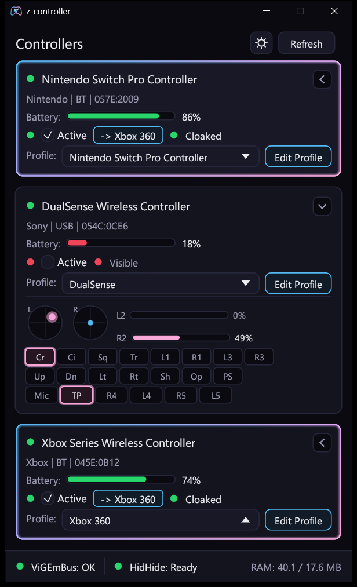
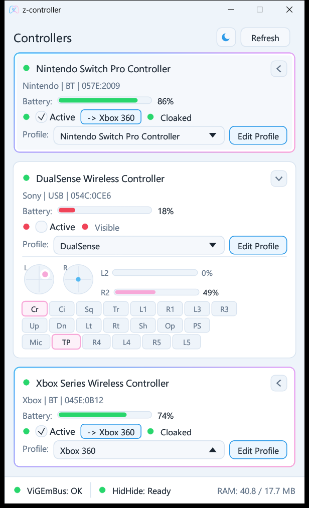

# z-controller

A lightweight Windows system-tray utility that reads all connected controllers, displays battery status, maps any controller to a virtual **Xbox 360** or **DualShock 4** controller ([ViGEmBus](https://github.com/nefarius/ViGEmBus)), and hides the physical pad ([HidHide](https://github.com/nefarius/HidHide)) so games see a single clean controller without double input.

| Dark Mode | Light Mode |
| :---: | :---: |
|  |  |

## Features

- **Multiple controllers at once**: Manage multiple physical pads simultaneously, each with its own virtual controller slot and assigned profile.
- **3 built-in profiles**: Ships with **Xbox 360**, **DualSense**, and **Nintendo Switch Pro Controller** profiles, plus support for creating custom profiles in the interactive controller-diagram Profile Editor.
- **Remapping & tuning**: Per-button remapping, A/B & X/Y face-button swap, independent left/right stick radial deadzones (`0%`–`50%`), rumble forwarding toggle, physical pad cloaking toggle, and disconnect behaviour (`Keep Neutral` / `Drop`).
- **Live input view**: Per-card expandable/collapsible real-time physical button, trigger, and stick visualizer.
- **Persistent per-controller state**: Toggle each controller's `Active` virtual pad on or off independently; per-controller active state, profile assignments, and live-view collapse states persist across launches (`%APPDATA%\z-controller\config.toml`).
- **Dark & light themes**: Instant sun/moon theme toggle in the header row, persisted across launches.

## Install & Quick-Start

1. Download `z-controller.exe` from [GitHub Releases](https://github.com/wintangz/z-controller/releases) and run it (single portable executable).
2. **Driver setup**: `ViGEmBus` and `HidHide` installers are bundled inside `z-controller.exe` and offered directly from the status bar on first run if either driver is missing (**HidHide requires a reboot** after installation to finish loading its driver).
3. **Quick-start**: Connect pad → enable **Active** on its card → pick output / profile → play.

## Known Limitations

- **Virtual output is Xbox 360 / DualShock 4 only**: `ViGEmBus` has no virtual Switch Pro target — for Switch emulators, use **DualShock 4** output with the Nintendo profile.
- **Gyro passthrough is not yet implemented**.

## Build from Source

### Prerequisites

- Windows 10/11 (x64)
- Rust stable MSVC toolchain (`x86_64-pc-windows-msvc`)
- Windows 10/11 SDK (`rc.exe` for embedding resources)
- 64-bit `SDL3.dll` placed at `vendor/sdl3-win64/SDL3.dll` (embedded at compile time)

### Build

```powershell
cargo build --release
```

The compiled executable is written to `target\release\z-controller.exe`.

## Credits

- [SDL3](https://github.com/libsdl-org/SDL) — cross-platform controller & gamepad input backend
- [SDL_GameControllerDB (`gamecontrollerdb`)](https://github.com/mdqinc/SDL_GameControllerDB) — community controller mapping database
- [ViGEmBus](https://github.com/nefarius/ViGEmBus) — Windows kernel-mode virtual Xbox 360 & DualShock 4 gamepad emulation
- [HidHide](https://github.com/nefarius/HidHide) — per-application HID device cloaking driver

## License

`z-controller` is licensed under the [MIT License](LICENSE). Third-party components keep their own licenses — see [THIRD-PARTY-LICENSES.md](THIRD-PARTY-LICENSES.md).
